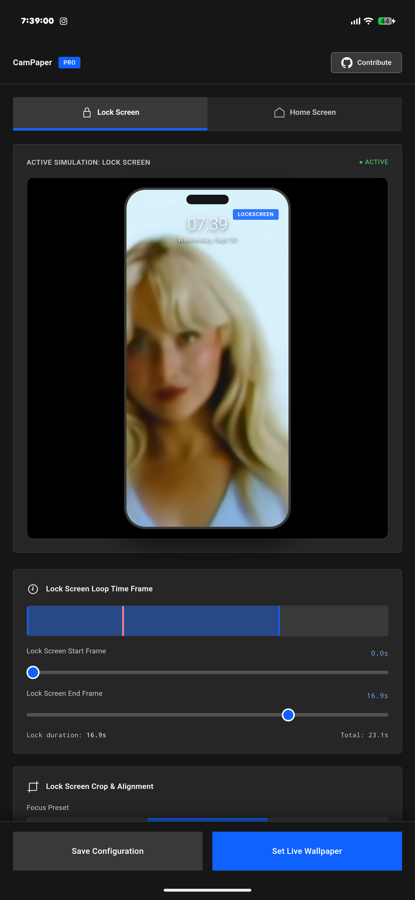
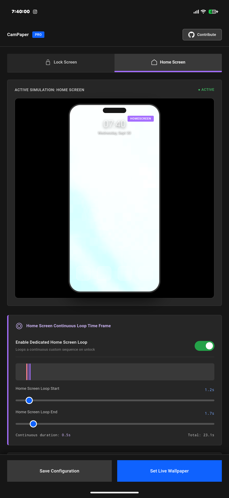

<div align="center">

# CamPaper

**Hardware-accelerated live video wallpaper engine for Android with dedicated Lock & Home screen workflows, sub-frame trimming, and real-time GLSL post-processing.**

[](https://android.com)
[](https://www.khronos.org/opengles/)
[](https://developer.android.com/media/media3)
[](LICENSE)

<br/>

<p align="center">
  
  &nbsp;&nbsp;&nbsp;&nbsp;
  
</p>

</div>

---

## Overview

Most video wallpaper apps simply stretch a raw MP4/WebM across the display and loop it blindly. CamPaper takes a different approach:

- **Independent Screen States**: Configure distinct crop viewports and time ranges for your Lock Screen versus your Home Screen.
- **Zero Aspect Distortion**: An OpenGL ES 2.0 pipeline dynamically calculates screen-to-video aspect ratio ratios (`videoRatio / screenRatio`) to ensure full-bleed display without stretching or squeezing.
- **Instant Wake Playback**: Uses an internal event bus combining `WallpaperService.Engine` visibility cycles with `ACTION_SCREEN_ON` and `ACTION_USER_PRESENT` broadcasts, waking ExoPlayer instantly without the typical Android blank-frame lag.
- **On-the-Fly GLSL Color Grading**: Real-time fragment shaders let you adjust exposure, contrast, saturation, and vignette, or pick from presets like Cine Film, Nordic Teal, Noir, and Amber Warmth without re-encoding the video file.

---

## Key Highlights

### 1. Dedicated Screen Tabs
* **Lock Screen Tab**: Fine-tune your intro frame window and horizontal/vertical focus points so faces or focal subjects line up cleanly behind your clock and widgets.
* **Home Screen Tab**: Pick a separate continuous loop segment (e.g. a subtle looping ambient motion) and shift the zoom/pan so desktop icons remain legible.

### 2. High-Precision Looping
* Sub-second precision handles lock playback and home wallpaper looping.
* Custom video files (WebM, MP4, MKV) can be imported directly via Android Storage Access Framework (`content://`).

### 3. Real-Time Shader Effects
Shader calculations run directly in the GLSL fragment stage:
* Presets: `None`, `Film Grain / Kodak`, `Nordic Teal`, `Vibrant Vivid`, `Monochrome Noir`, `Amber Sunset`.
* Micro-adjustments: Fine slider tuning for Brightness, Contrast, Saturation, and Corner Vignette falloff.

### 4. Companion Controller UI
Built using the **IBM Carbon Design System** aesthetic with **Geist** typography:
* High-contrast dark interface (`#161616` / `#262626`).
* Live simulated phone viewport showing real-time cropping and color grading before applying changes system-wide.

---

## Architecture

```
CamPaper Architecture
├── MainActivity (Companion UI)
│   ├── WebView + Local Carbon/Geist Assets
│   ├── AndroidBridge (JavaScript Interface)
│   └── System SAF File Picker
│
├── VideoWallpaperService (Live Wallpaper Engine)
│   ├── GLRenderThread (EGLContext & EGLDisplay lifecycle)
│   ├── Keyguard State Detector (Lock vs. Home context switching)
│   ├── Screen Wake BroadcastReceiver (Instant resume)
│   └── Media3 ExoPlayer Instance (Loop & seek constraints)
│
└── VideoGLRenderer (OpenGL ES 2.0)
    ├── Aspect-Ratio Cover Matrix (`uMVPMatrix`)
    ├── Pan & Zoom Transform (`uSTMatrix`)
    └── Dynamic GLSL Fragment Shader (Color grading & Vignette)
```

---

## Getting Started

### Prerequisites
* Android Studio Iguana / Jellyfish or command-line Android SDK.
* JDK 17.
* Android device or emulator running **Android 8.0 (API 26)** or higher.

### Building from Source

1. Clone the repository:
   ```bash
   git clone https://github.com/nissshhdev/CamPaper.git
   cd CamPaper
   ```

2. Build the debug APK:
   ```bash
   ./gradlew assembleDebug
   ```

3. Install onto your connected device:
   ```bash
   adb install -r app/build/outputs/apk/debug/app-debug.apk
   ```

4. Launch CamPaper:
   ```bash
   adb shell am start -n com.nissshh.campaper/.MainActivity
   ```

---

## Setting up as Live Wallpaper

1. Launch **CamPaper**.
2. Configure your desired video source, crop positioning, and loop windows.
3. Tap **Set Live Wallpaper**.
4. When the system prompt appears, choose **Home screen and lock screen**.
5. Lock and unlock your phone to watch the dynamic screen transitions in action.

---

## Contributing

Contributions, issues, and feature requests are welcome. Feel free to check the [issues page](https://github.com/nissshhdev/CamPaper/issues) if you would like to contribute.

1. Fork the Project
2. Create your Feature Branch (`git checkout -b feature/AmazingFeature`)
3. Commit your Changes (`git commit -m 'Add some AmazingFeature'`)
4. Push to the Branch (`git push origin feature/AmazingFeature`)
5. Open a Pull Request

---

## License

Distributed under the Apache License 2.0. See `LICENSE` for more information.
